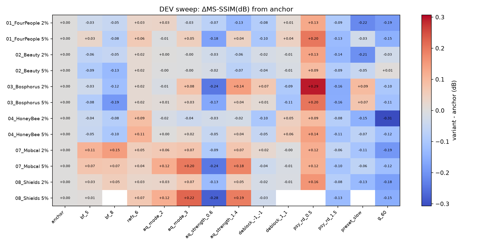
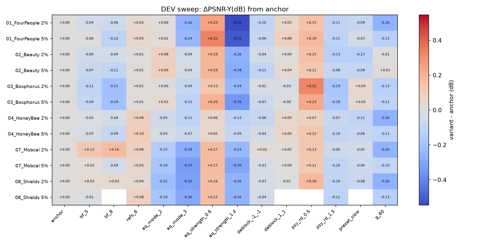

# CS5185 内容自适应视频编码 v2 实验报告

## 1. 本次改动摘要（Review1 问题 1–6）

| Review | v2 处理 | 代码/证据 |
|---|---|---|
| 1 内容影响参数 | 预注册扫描→DEV-only 分析→冻结规则→VAL 检查。只得到一条 bpp→AQ-mode 规则；没有把它包装成纯运动/纹理规则。 | `src/experiment.py:24-29, 259-348, 371-456`；`src/rules_v2.json`；DEV 热力图见下文。 |
| 2 文件大小上限 | 仅接受 `-3% ≤ size_error ≤ 0`；超过目标会按反馈重编码。4 次上限。 | `src/evaluate.py:69-85`；`src/pipeline.py:12-15, 27-85`；`src/config.py:18-20`。 |
| 3 MS-SSIM | 用 FFmpeg 解码成原始 Y 平面，检查两路都完整且帧数等于 metadata；评测输出 MS-SSIM、dB、最小值及逐帧数组，另做 PyTorch 参考对齐。 | `src/ms_ssim.py:12-61, 64-144`；`src/evaluate.py:52-94`；对齐 CSV。 |
| 4 主观材料 | 为 TEST 每视频×每档生成原始/B0/A 三联帧（含差异区域放大）和并排短片，并生成逐项观察表。人工观察在最终结果完成后补录。 | `src/report.py:45-149`。 |
| 5 数据泄漏 | DEV/VAL/TEST 在配置中显式分开；sweep/derive 拒绝非 DEV；final 要求 tag 指向 HEAD 且工作区干净。冻结前未运行 v2 TEST。 | `src/config.py:22-26`；`src/experiment.py:33-40, 522-567`；标签 `frozen-v2`（冻结提交待写入最终报告）。 |
| 6 完整性与隔离 | 每次运行使用独立目录，成功候选须解码、帧数、时长、分辨率、帧率及大小均合格；保留尝试与输出文件。 | `src/experiment.py:63-71`；`src/evaluate.py:69-94`；`src/pipeline.py:17-117`。 |

**已知旧数据处理偏离：**任务书提到把 `logs/*.jsonl` 移到外部 `legacy/logs/`。按调用者要求，外部 `legacy/` 目录保持只读；这些旧日志已随早期 v2 框架提交移动至仓库内 `archive/v1_logs/`，没有改动外部归档或数据集。历史内容未参与 v2 规则拟合。旧 `docs/design.md`、旧 `results/` 的有意删除在第一阶段提交中提交。

## 2. 环境与可复现命令

环境记录：Windows 11；Python 3.14.7；AMD64，32 逻辑 CPU；每个编码任务 `-threads 4`，正式最终实验串行；FFmpeg 7.1 essentials，带 libx264；NumPy 2.5.3、OpenCV headless 5.0.0.93、Matplotlib 3.11.2、imageio-ffmpeg 0.6.0。系统未安装 ffprobe。对齐校验单独使用 Python 3.12 venv `D:/gcg/Multimedia/project/_venv_msssim`、CPU PyTorch 2.15.0 与 pytorch-msssim 1.0.0。扫描 run_config 在依赖版本采集修正前写出，故其 OpenCV 包字段为 null；VAL 记录则识别为 headless 5.0.0.93。

```powershell
$env:CS5185_DATASET = 'D:\gcg\Multimedia\project\CS5185_Project_Video_Dataset'
python run.py check-retry
python run.py sweep --run sweep_v2
python run.py align-check --run sweep_v2
python run.py derive --run sweep_v2
python -m pytest -q tests/test_decide.py
python run.py validate --run val_v2
# 检查并提交冻结代码、规则与预注册报告，确认工作区干净
# git tag -a frozen-v2 -m 'Freeze v2 rules after DEV and VAL'
python run.py final --run final_v2
python run.py report --run final_v2
```

重复运行需给每个不可覆盖的运行目录选择新的名称。最终测试只允许在 `frozen-v2` 后执行一次；本报告的 TEST 结果将在该运行及报告生成后补录。数据集来源由 metadata SHA-256 校验；不使用仓库内旧 `data/raw/`。

## 3. MS-SSIM 实现与对齐校验

实现逐路调用 FFmpeg 解码灰度原始帧（相当于 Y/luma 评测通道），按 metadata 的 1280×720 读取；参考与失真视频逐帧配对，并要求两路都结束且帧数等于原视频（06 为 75 帧，其余为 150 帧）。单帧实现采用 data range 255、5 个尺度、11×11 Gaussian 窗口、sigma=1.5、标准权重 `(0.0448, 0.2856, 0.3001, 0.2363, 0.1333)`，逐尺度下采样；视频指标为逐帧 MS-SSIM 算术平均，随后计算 `-10 log10(1-mean)`，并保留逐帧得分、最小值。实现及参数见 `src/ms_ssim.py`。

`results/checks/msssim_alignment.csv` 含 3 个 DEV 视频各 10 帧，共 30 个逐帧对照值。相对 pytorch-msssim 的最大绝对差为 `1.8034227472485398e-6`；CPU PyTorch 2.15.0、pytorch-msssim 1.0.0。自比较得分为 1.0；噪声标准差 1、2、5、10 的得分依次严格降低（`msssim_alignment_basic.json`）。该差值远低于代码验收阈值 `1e-4`。

无 ffprobe，因此 `file_kbps` 是按完整文件字节/时长计算；`actual_video_kbps` 由 FFmpeg stream-copy 统计估算而非 ffprobe packet size。两者在报告中区分，后者精度受 FFmpeg 汇总单位限制。

## 4. 数据划分与防泄漏措施

- DEV：01、02、03、04、07、08；仅这些视频可参与扫描和规则推导。
- VAL：11、12；只在规则冻结前作推广检查，不选参。
- TEST：05、06、09、10；v2 在规则冻结前没有编码或参与选择。冻结 tag 和 TEST 主结果将在最终补录。
- `require_development_ids()` 在 sweep/derive 入口拒绝 DEV 以外视频；`final_guard()` 检查 `frozen-v2` 指向当前 HEAD 且工作区没有未提交文件。测试集历史 v1 记录仅作为归档，不进入 v2 决策。

## 5. DEV 扫描结果

预注册：锚点为 medium / g=150 / bf=3 / refs=3 / AQ=1 / strength=1.0 / deblock=0:0 / psy-rd=1.0:0。每次仅变更一个维度，6 个 DEV × 2 档，共锚点和 13 个变体，168 个候选闭环。显著改善事先定义为 ΔMS-SSIM(dB) ≥ +0.10 且 ΔPSNR-Y ≥ −0.30 dB。内容分组阈值只能在预注册的 `edge_ratio`、`mafd`、`luma_std`、`bpp` 中按 DEV 样本中点分割。





完整逐候选记录：[sweep_summary.csv](../results/runs/sweep_v2/sweep_summary.csv)；逐维最优值：[best_values.csv](../results/runs/sweep_v2/best_values.csv)。成功 164/168，失败 4/168，全部为 08_Shields 5% 的 bf=8、deblock=1:1、psy-rd=0.5、preset=slow；经过 4 次反馈仍未同时落入 `-3%..0` 大小窗口。成功候选 `size_error` 范围 `-0.029251073237191845` 至 `-0.00005993498087936329`。

下表是 CSV 中每个变体相对锚点的平均 Δ（仅计通过验收的配对样本）；“显著数”按上述预注册双指标标准：

| 维度 | 设置 | 配对数 | 平均 ΔMS-SSIM(dB) | 平均 ΔPSNR-Y(dB) | 显著样本数 |
|---|---:|---:|---:|---:|---:|
| bf | 5 | 12 | -0.012162353 | -0.020888058 | 1 |
| bf | 8 | 11 | -0.048203815 | -0.063518430 | 1 |
| refs | 6 | 12 | +0.045830630 | +0.045739629 | 1 |
| AQ-mode | 2 | 12 | +0.028581306 | -0.049896265 | 2 |
| AQ-mode | 3 | 12 | +0.055479503 | -0.183082617 | 1 |
| AQ-strength | 0.6 | 12 | -0.126266418 | +0.168997983 | 0 |
| AQ-strength | 1.4 | 12 | +0.039249585 | -0.286892838 | 2 |
| deblock | -1:-1 | 12 | -0.031660688 | -0.051961193 | 0 |
| deblock | 1:1 | 11 | -0.007761941 | +0.022633085 | 0 |
| psy-rd | 0.5 | 11 | +0.152632981 | +0.159533027 | 9 |
| psy-rd | 1.5 | 12 | -0.109730864 | -0.112181883 | 0 |
| preset | slow | 11 | -0.077144605 | -0.058574499 | 0 |
| g | 60 | 12 | -0.137493206 | -0.145068827 | 0 |

psy-rd=0.5 在 11 个成功样本中表现出较高平均值，但 08_Shields 5% 未能通过大小验收，无法据此声称它在全部 DEV 上一致更好；另有 2 个成功样本未达到预注册“显著”门槛。其他维度也未形成同时满足“改善/非改善分组可由单一预注册特征阈值完全分开”的内容规则。故除下述单条规则外，保持锚点设置，不臆测运动/纹理映射。

## 6. DEV 规则、留一法与 VAL

### 冻结前得到的规则

`bpp > 0.26137514467592593 → aq-mode=2；否则 aq-mode=1`。中点阈值只由 DEV 扫描样本产生；规则定义在 `src/rules_v2.json`。满足显著条件并落入高 bpp 侧的样本为 07_Mobcal 5%（ΔMS-SSIM(dB) `+0.12048569826709254`，ΔPSNR-Y `-0.18495767514929184`）及 08_Shields 5%（`+0.11830530203227951`，`-0.18967054982965692`）。`mafd`、`edge_ratio`、`luma_std` 没有满足该规则标准的分隔。因此这是一条把目标预算/分辨率合成 `bpp` 后得到的 **预算相关规则**，不是已证实的纯内容特征规则；当前证据不足以宣称运动或纹理特征真正驱动了选择。

### 留一法

按视频留一，共 96 条（8 个参数维度×每个留出视频两个预算）；预测与 oracle 参数一致 40/96。相对 oracle 的平均 MS-SSIM(dB) 损失 `0.04362710941110234`，最大 `0.2931913676143374`。只看 AQ-mode，预测一致 2/12，平均损失 `0.03826607410551238`。完整表：[loocv.csv](../results/runs/sweep_v2/loocv.csv)。留一统计包括无内容规则的参数维度，其值通常回退锚点；不应误读为仅评估那条 AQ 规则。

### VAL 检查

VAL 共 8 个 A/B1 编码结果全部通过硬性验收。4 个配对的 A−B1 平均 ΔPSNR-Y 为 `-0.09698377371118916 dB`，胜/负/平为 1/3/0；平均 ΔMS-SSIM(dB) 为 `-0.0896528456999155 dB`，胜/负/平同为 1/3/0。所有 VAL bpp 均低于冻结阈值，规则分支没有触发，所以这只是回退分支检查，并未验证阈值另一侧的泛化表现。明细：[val_check.csv](../results/runs/val_v2/val_check.csv)。

## 7. 最终实验：TEST 主表、DEV/VAL 附表与大小验收

待 `frozen-v2` 后唯一一次 `final_v2` 执行并生成报告；不得依据测试表现修改规则。结果完成后，在此节添加 TEST A−B1、A−B0 的 ΔPSNR-Y、ΔMS-SSIM(dB)、胜负平、逐视频明细、DEV/VAL 附表及每组 `size_error` 验收。HTML 索引预期为 `results/runs/final_v2/index.html`。

## 8. 主观材料与观察表

待 TEST 三联帧与 8 个 B0/A 并排短片生成后逐张打开 PNG、检查网页和视频。静态帧无法判断运动平滑度时写“未确认”；不根据自动指标编造主观现象。材料和 `subjective_notes.csv` 位于 `results/runs/final_v2/`。

## 9. 案例：检测→参数→理由

DEV 扫描显示 AQ-mode=2 只在两个高预算率样本达到显著门槛，bpp 中点阈值将它们与非改善样本分开。决策函数按该 bpp 阈值选择 AQ-mode=2，否则回退 AQ-mode=1；理由字符串包含观测值、实际比较分支、所选参数及扫描来源。TEST 案例（05_Jockey 5%）须在最终运行后按其真实特征、规则分支、B0/A 参数和逐帧曲线补充；不得提前用 TEST 选择阈值。

## 10. 局限与未完成项

- 当前唯一规则是 bpp 预算代理而非纯内容特征；因此 Review 的核心要求“不同内容特征驱动不同参数”没有获得强证据，报告如实保留此结论。
- VAL 全在阈值低侧；高侧只有 DEV 两个改善视频，泛化证据有限。
- psy-rd=0.5 的平均改善明显，但因一个 DEV 配对大小失败，且未能通过分组阈值规则，未转成内容规则。
- ffprobe 不可用，视频包码率是 FFmpeg 汇总估算；完整文件码率准确按文件长度计算。
- 扫描的 `run_config.json` 记录早于 opencv-headless 版本发现修正；原文件保留，VAL 与最终运行配置可提供已发现版本信息。
- 特征全 12 视频提取是在 DEV 扫描启动后补跑；规则拟合严格只读取 DEV 行，VAL 单独编码，TEST 在冻结前未用于 v2 调参。
- 历史 v1 日志按调用者的只读约束留在仓库 `archive/v1_logs/`，没有移入外部只读 `legacy/`。
- TEST 最终指标、主观观察、完整逐视频表和案例图在冻结后补入；其余实验数字全部来自 run CSV/JSON，没有估算。
