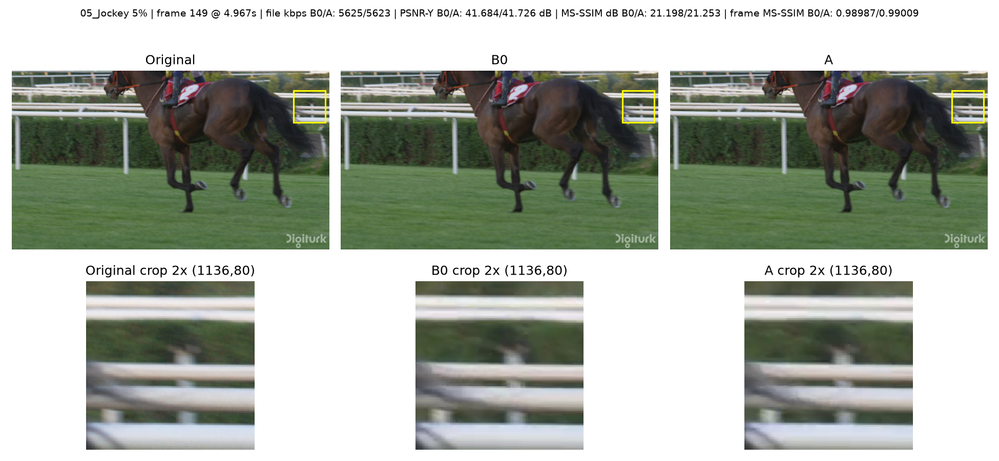
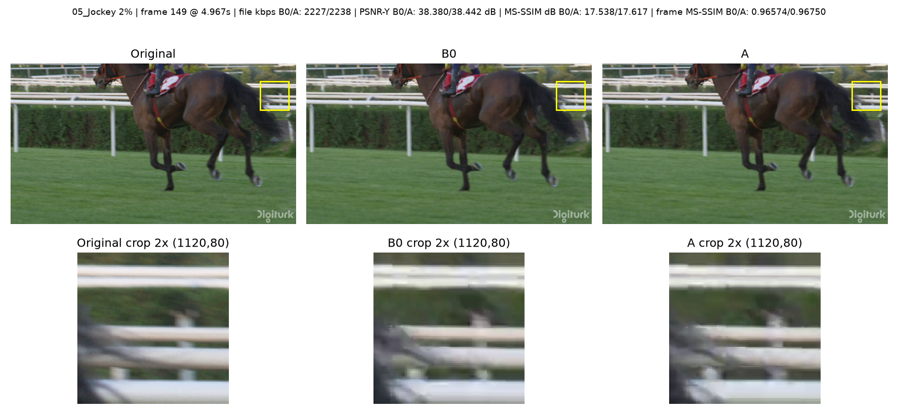
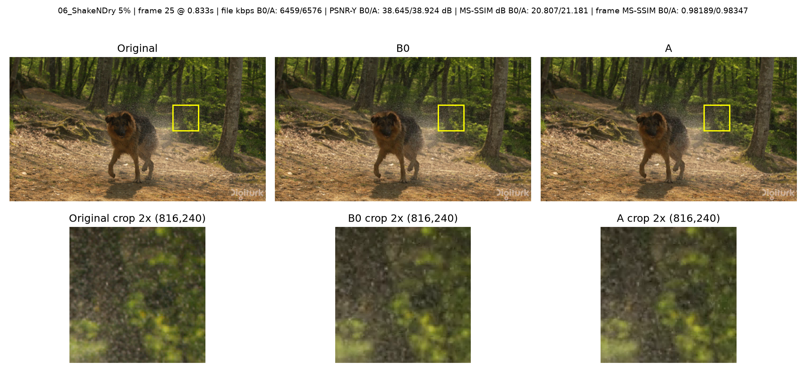
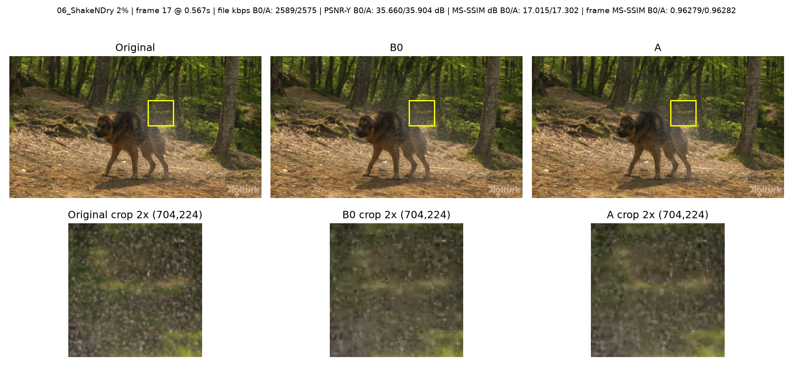
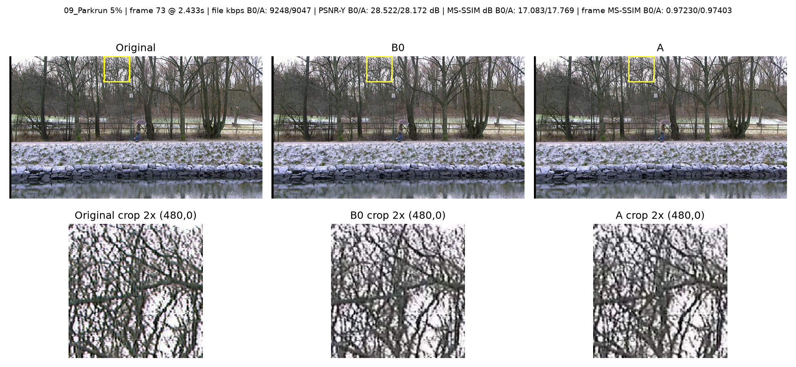
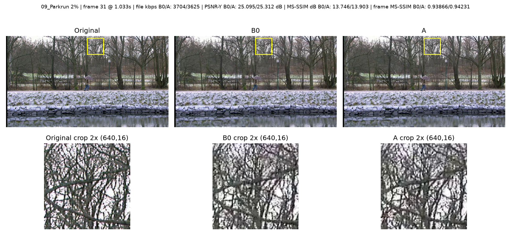
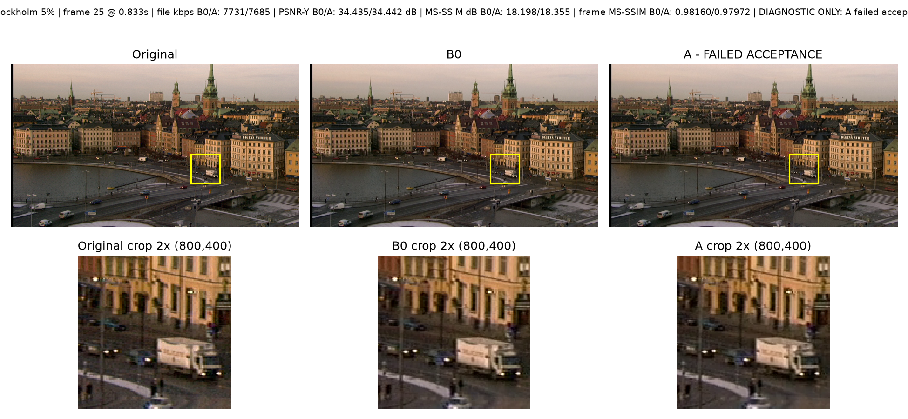
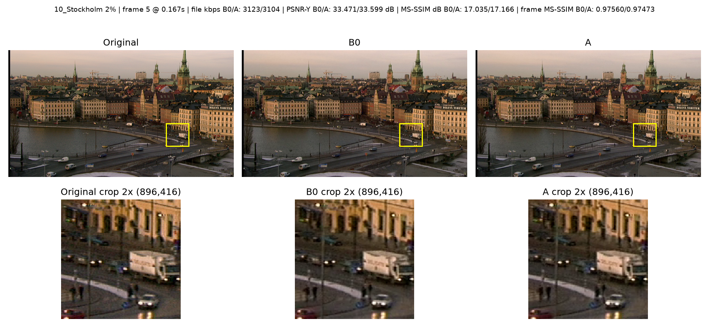
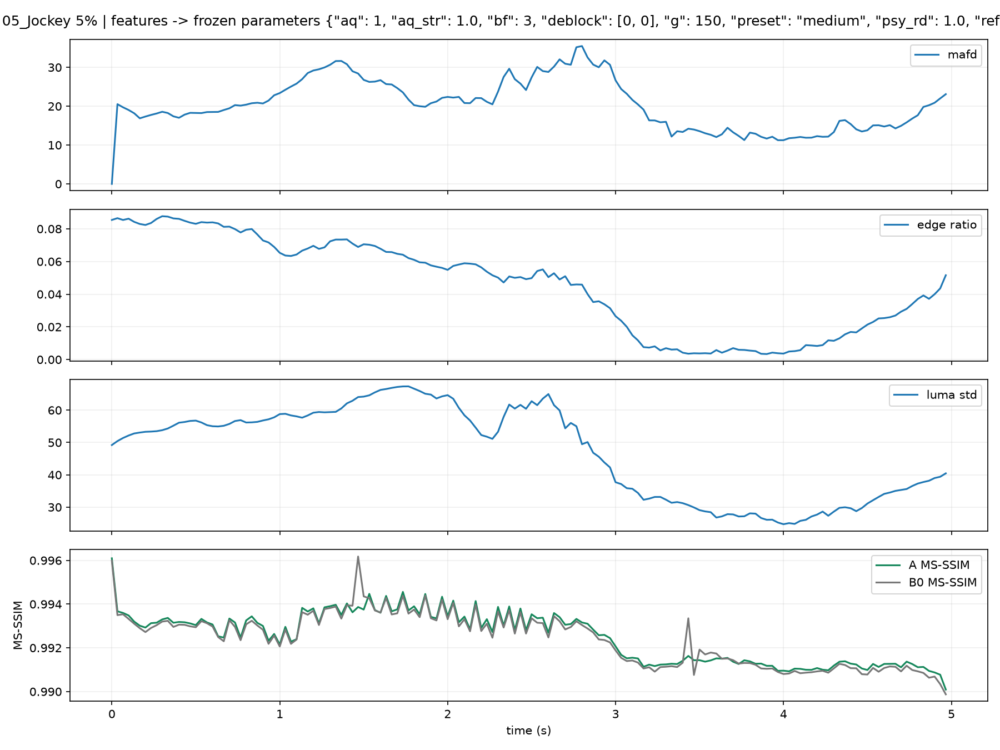

# CS5185 内容自适应视频编码 v2 实验报告

## 1. 改动摘要（Review1 问题 1–6）

| Review | 本次处理与证据 |
|---|---|
| 1 内容→参数 | 在扫描前预注册标准；sweep/derive 限定 DEV；仅以 DEV 扫描推导并冻结 1 条规则。它是 bpp（目标预算率）规则，不是已证明的运动/纹理内容规则。`src/experiment.py:24-29,259-348,371-456`、`src/rules_v2.json`、`src/decide.py:28-52`。 |
| 2 体积上限 | 验收为 `-3% ≤ size_error ≤ 0`，超过上限重试；4 次上限。`src/evaluate.py:69-94`、`src/pipeline.py:12-15,27-85`、`src/config.py:18-20`。 |
| 3 MS-SSIM | 以 FFmpeg 灰度/Y 平面逐帧比较，强制两路完整解码且帧数匹配；输出平均值、dB、最小值和逐帧值；对照 PyTorch 参考实现。`src/ms_ssim.py:12-61,64-144`、`src/evaluate.py:52-94`。 |
| 4 材料 | 生成 TEST 的 16 张三联帧、8 个原始/B0/A 三路并排短片、主观观察 CSV 和 HTML 索引；未通过验收的 Stockholm 5% 仅作为明确标记的诊断材料。`src/report.py:71-170,382-443`。 |
| 5 数据泄漏 | 划分常量位于 `src/config.py:22-26`；DEV-only guard 位于 `src/experiment.py:33-40`；final 检查 tag 与干净工作区位于 `src/experiment.py:522-567`。测试集只在冻结 tag 后运行一次。 |
| 6 完整性/隔离 | 每个 run 独立目录；候选必须通过解码、帧数、时长、分辨率、帧率和体积检查才算成功。`src/experiment.py:63-71`、`src/evaluate.py:69-94`、`src/pipeline.py:17-117`。 |

**归档偏离：**任务书要求把旧 `logs/*.jsonl` 移至外部只读 `legacy/logs/`；按调用者要求未改外部 `legacy/`，而将历史日志随 v2 框架提交移入仓库 `archive/v1_logs/`。日志未用于 v2 拟合。旧版 `docs/design.md` 和 `results/` 的有意删除随首个阶段提交。数据集目录保持只读。

## 2. 环境与复现

最终运行记录环境：Windows 11、Python 3.14.7、AMD64 32 逻辑 CPU、FFmpeg 7.1 essentials/libx264；编码任务 4 threads，final 串行；NumPy 2.5.3、OpenCV headless 5.0.0.93、Matplotlib 3.11.2、imageio-ffmpeg 0.6.0。E1 独立环境为 Python 3.12、CPU PyTorch 2.15.0、pytorch-msssim 1.0.0。未安装 ffprobe。扫描 run_config 的 OpenCV 版本在采集修正之前记录为 null；VAL/final run_config 已记录 headless 5.0.0.93。

```powershell
$env:CS5185_DATASET = 'D:\gcg\Multimedia\project\CS5185_Project_Video_Dataset'
python run.py check-retry
python run.py features --run features_v2
python run.py sweep --run sweep_v2
python run.py align-check --run sweep_v2
python run.py derive --run sweep_v2
python -m pytest -q tests/test_decide.py
python run.py validate --run val_v2
# 历史正式运行在干净的 frozen-v2 提交；独立复现应在该 tag 执行 final，不要移动 tag
# （远程没有该 tag：git tag frozen-v2 55516859a134dfbdf64a5811a33ed9a344fb9820 && git checkout frozen-v2）
python run.py final --run final_v2
# 生成展示材料时回到 v2 分支，使用其报告器
git checkout v2
python run.py report --run final_v2
```

TEST 只在冻结 tag 后运行一次。重现时请为已存在的 run 目录选择新名称，程序不会覆盖已有目录。数据集哈希验证在 final run_config 中为通过；不使用仓库旧 `data/raw/`。v1 日志只作归档，不进入 v2 规则。

## 3. MS-SSIM 与对齐校验

视频输入由 FFmpeg 解码为灰度/Y 平面帧，按 metadata 分辨率逐帧对齐；预期帧数为 06 的 75 帧、其他视频各 150 帧，任一路少帧、多帧或解码失败都会使测量失败。单帧参数：data range 255、5 尺度、11×11 Gaussian 窗口、sigma 1.5、权重 `(0.0448, 0.2856, 0.3001, 0.2363, 0.1333)`，逐级下采样。视频 ms_ssim 是逐帧算术平均；`ms_ssim_db=-10 log10(1-ms_ssim)`；同时记录最小值和逐帧序列。实现：`src/ms_ssim.py`。

`results/checks/msssim_alignment.csv` 有 3 个 DEV 视频各 10 帧，共 30 对；相对 pytorch-msssim 的平均绝对差 `6.4532750951862285e-7`、最大绝对差 `1.8034227472485398e-6`（阈值 `1e-4`）。自比较为 1.0；加噪标准差 1、2、5、10 后分数依次下降，见 `results/checks/msssim_alignment_basic.json`。

无 ffprobe，所以 `file_kbps` 用完整文件大小/时长计算；`actual_video_kbps` 是 FFmpeg stream-copy 汇总估算，不是 ffprobe packet-size 精确值，两列不应混为一谈。

## 4. 划分、防泄漏与冻结

- DEV：01、02、03、04、07、08，仅用于扫描和规则推导。
- VAL：11、12，仅用于冻结前检查，不选参。
- TEST：05、06、09、10，v2 final 前没有用于规则拟合；冻结后执行唯一一次 `final_v2`。
- `sweep/derive` 只允许 DEV IDs；`final` 要求 `frozen-v2` 指向当前 HEAD 且开始时工作区干净。
- 冻结 tag `frozen-v2` 指向 commit `55516859a134dfbdf64a5811a33ed9a344fb9820`（短 hash `5551685`）。Final 的 `run_config.json` 记录相同 commit、`git_dirty=false`、数据集哈希通过。代码分支为 `v2`，已推送到 `origin/v2`；`frozen-v2` tag 仅在本机，远程没有。

冻结后仅对 `src/report.py` 作报告修正：让未通过验收的 A 候选也生成标有诊断用途的三联帧/短片，并在 HTML 标红失败行、标注诊断短片。同时保留已有人工观察表，避免重建报告时覆盖。没有改编码器决策、参数、输入或重跑 final；因此 tag 保持在实际编码使用的冻结提交，分支最新报告提交在 tag 之后。

## 5. DEV 扫描结果

扫描前固定锚点 medium / g=150 / bf=3 / refs=3 / AQ-mode=1 / strength=1.0 / deblock=0:0 / psy-rd=1.0:0；每次只改变一维。6 个 DEV × 2 档，锚点加 13 变体，合计 168 候选。预注册“显著改善”为 ΔMS-SSIM(dB) ≥ +0.10 且 ΔPSNR-Y ≥ −0.30 dB。候选和图：[`sweep_summary.csv`](../results/runs/sweep_v2/sweep_summary.csv)、[`sweep_heatmap_msssim.png`](../results/runs/sweep_v2/figs/sweep_heatmap_msssim.png)、[`sweep_heatmap_psnr.png`](../results/runs/sweep_v2/figs/sweep_heatmap_psnr.png)；每维最优值见 [`best_values.csv`](../results/runs/sweep_v2/best_values.csv)。


通过 164/168，失败 4 个：均为 08_Shields 5% 的 bf=8、deblock=1:1、psy-rd=0.5、preset=slow；经过 4 次仍无法进入 `-3%..0` 区间。成功候选的 size_error 最小/最大为 `-0.029251073237191845` / `-0.00005993498087936329`。

下表为每变体相对锚点的平均差，只对通过硬性验收的配对计数；显著数按预注册的双指标门槛：

| 维度 | 变体 | 成功配对 | 平均 ΔMS-SSIM(dB) | 平均 ΔPSNR-Y(dB) | 显著数 |
|---|---:|---:|---:|---:|---:|
| bf | 5 | 12 | -0.012162353 | -0.020888058 | 1 |
| bf | 8 | 11 | -0.048203815 | -0.063518430 | 1 |
| refs | 6 | 12 | +0.045830630 | +0.045739629 | 1 |
| AQ-mode | 2 | 12 | +0.028581306 | -0.049896265 | 2 |
| AQ-mode | 3 | 12 | +0.055479503 | -0.183082617 | 1 |
| AQ-strength | 0.6 | 12 | -0.126266418 | +0.168997983 | 0 |
| AQ-strength | 1.4 | 12 | +0.039249585 | -0.286892838 | 2 |
| deblock | -1:-1 | 12 | -0.031660688 | -0.051961193 | 0 |
| deblock | 1:1 | 11 | -0.007761941 | +0.022633085 | 0 |
| psy-rd | 0.5 | 11 | +0.152632981 | +0.159533027 | 9 |
| psy-rd | 1.5 | 12 | -0.109730864 | -0.112181883 | 0 |
| preset | slow | 11 | -0.077144605 | -0.058574499 | 0 |
| g | 60 | 12 | -0.137493206 | -0.145068827 | 0 |

psy-rd=0.5 的 11 个有效配对中平均改善突出，但 08_Shields 5% 未通过大小验收；不能声称该变体在全部 DEV 样本上一致更好，也未找到通过单一预注册特征中点阈值分隔改善与非改善组的规则。`mafd`、`edge_ratio`、`luma_std` 都未得到满足判据的决策规则。没有编造内容映射；未支持的维度退回锚点。

## 6. 冻结规则、LOOCV、VAL

唯一规则：`bpp > 0.26137514467592593 → AQ-mode=2；否则 AQ-mode=1`，见 `src/rules_v2.json`。阈值来自 DEV 样本中点。AQ-mode=2 两个显著样本为 07_Mobcal 5%（ΔMS-SSIM `+0.12048569826709254 dB`、ΔPSNR-Y `-0.18495767514929184 dB`）和 08_Shields 5%（`+0.11830530203227951 dB`、`-0.18967054982965692 dB`）。其他预注册特征没有得到此规则。**因此 bpp 是将视频空间预算率和分辨率合成后的预算相关代理；本结果不证明纯运动或纹理特征改变了参数。**

留一法共 96 行（每留出视频、预算和参数维度），参数与 oracle 一致 40/96；MS-SSIM(dB) 损失平均 `0.04362710941110234`，最大 `0.2931913676143374`。AQ-mode 子集一致 2/12，平均损失 `0.03826607410551238`。明细：[`loocv.csv`](../results/runs/sweep_v2/loocv.csv)。该总一致率包含没有规则的各参数维度，不能解释为只测 AQ 规则。

VAL 8/8 组 A/B1 编码通过硬性验收。4 个 A−B1 配对的平均 ΔPSNR-Y `-0.09698377371118916 dB`、平均 ΔMS-SSIM(dB) `-0.0896528456999155 dB`；两个指标的胜/负/平计数均为 1/3/0。全部 VAL bpp 低于阈值，规则高侧没有触发；因此 VAL 仅检查了锚点回退分支，没有提供阈值另一侧的独立验证。明细：[`val_check.csv`](../results/runs/val_v2/val_check.csv)。

## 7. Final 实验：TEST 主结果、DEV/VAL 附表与大小验收

final 串行执行 12 视频 × 2 档 × B0/B1/A，共 72 组；正式总耗时 `3949.417858300003 秒`。摘要和逐行结果：[`summary.csv`](../results/runs/final_v2/summary.csv)、[`comparisons.csv`](../results/runs/final_v2/comparisons.csv)、[`phase_timing.json`](../results/runs/final_v2/phase_timing.json)。比较只使用两组均 `status=ok` 的配对；TEST 为 8 个预算组合中 7 个有效配对，因为 10_Stockholm 5% 的 A 失败。

| TEST 比较（有效配对 n=7） | 平均 ΔPSNR-Y | PSNR 胜/负/平 | 平均 ΔMS-SSIM(dB) | MS-SSIM 胜/负/平 |
|---|---:|---:|---:|---:|
| A−B1 | -0.07447467630169465 dB | 2/4/1 | +0.06614078252185861 dB | 3/3/1 |
| A−B0 | +0.08884749671659366 dB | 6/1/0 | +0.2526249232827765 dB | 7/0/0 |

### TEST：拆开规则触发与未触发的 A−B1

| 冻结规则分支 | 有效配对 / 总数 | 平均 ΔPSNR-Y (dB) | 平均 ΔMS-SSIM (dB) | PSNR 胜/负/平 | MS-SSIM 胜/负/平 |
|---|---:|---:|---:|---:|---:|
| 未触发：A 与 B1 均为 AQ=1 | 6/6 | −0.011448 | −0.015705 | 2/3/1 | 2/3/1 |
| 触发：A 为 AQ=2，B1 为 AQ=1 | 1/2 | −0.452637 | +0.557213 | 0/1/0 | 1/0/0 |

未触发的 6 对没有参数干预，差值不能算规则收益。仅有的合格触发项是 **09_Parkrun 5%**：AQ=2 提高了 MS-SSIM，却降低了 PSNR-Y；后者低于预注册下限 −0.30 dB，因此按双指标标准**不算显著更好**。换言之，7 对的平均 ΔMS-SSIM 为正，不等于规则有稳定收益。

另一触发项 **10_Stockholm 5%** 的目标为 4,965,464 字节。[逐轮日志](../results/runs/final_v2/attempts.jsonl)记录的 4 轮大小依次为 4,665,825、4,758,693、**5,217,293**、4,802,949 字节；第 3 轮超标 **5.0716%** 后重试，并非四轮都未超标。最终第 4 轮完整解码（150 帧、5.0 秒），小于目标 **3.2729%**：满足项目的不超标和完整播放要求，只未达到实验自设的 −3% 接近度下限。它在 A 的体积通过率中计为失败（TEST 7/8，全量 23/24），在 A−B1 和 A−B0 的均值及胜负平中均不配对；图像和逐行指标保留供诊断。

### 10_Stockholm 5% 的 A 组：未通过验收的分析

验收窗口为 −3% ≤ 体积误差 ≤ 0。该组在给定的 4 个反馈轮次内多次接近这一窗口，但没有落入。按 [`attempts.jsonl`](../results/runs/final_v2/attempts.jsonl) 的记录：

| 轮次 | 使用码率 (kbps) | 体积 (字节) | 与目标 4,965,464 的误差 | 结果 |
|---|---:|---:|---:|---|
| 1 | 7786 | 4,665,825 | −6.03% | 低于下限，上调 |
| 2 | 8286 | 4,758,693 | −4.16% | 低于下限，继续上调 |
| 3 | 8646 | 5,217,293 | **+5.07%** | 超标，不合格，回调 |
| 4 | 8064 | 4,802,949 | −3.27% | 未超标，但距下限还差 0.27 个百分点 |

该组在正式统计中计为 A 的体积验收失败，不进入配对均值和胜负平；它的三联帧、短片和观察保留，并统一标注为诊断。

值得注意的是：第 4 轮用 8064 kbps 得到的体积（4,802,949）反而大于第 2 轮用 8286 kbps 的体积（4,758,693）——体积并不随码率单调变化。这使得“按比例缩放码率”的反馈公式在这一组上失去依据，也是下面三条改进方案共同针对的原因。

**可能的改进方案：**

1. **码率修正由整体缩放改为插值。** 当前公式为 `新码率 = 当前码率 × 目标 ÷ 实际 × 0.98`，隐含体积与码率成正比。第 3 轮码率只比第 2 轮高 4.3%，体积却跳了 9.6%，比例假设已经失效。已有两个以上观测点之后，应改用夹住目标的两点做线性插值（割线法），并以窗口中心而不是目标本身作为插值目标，以减少落到窗口之外的概率。注意这只在体积随码率大致单调时才有效，上面第 4 轮与第 2 轮的反例说明还需要配合第 5 条。
2. **超标之后收紧回调步长，避免来回震荡。** 当前单轮调整幅度的上限是 ±30%，对 3% 宽的窗口来说过大。一次超标（如第 3 轮）出现之后，下一轮的回调幅度应限制为刚才上调幅度的一部分（例如一半），使后续轮次在“已知偏低”和“已知偏高”两个点之间收敛，而不是再次跨过窗口。
3. **提高编码确定性（`-threads 1`）。** 多线程编码下同一条命令的输出不是逐字节确定的（见第 10 节），同一码率可能得到不同体积，反馈环的落点因此带有随机性；这也是第 4 轮体积反常的可能原因之一。改用单线程可使每一轮结果可复现，插值和步长策略才有稳定的输入。代价是编码耗时增加，需要在报告中另行记录。目前只有单个案例（11_Sintel 2%）验证了单线程逐字节一致，尚未对本组做同样的复现。

另有一种做法是放宽自设窗口的下限（例如改成 −4%），这一组即可通过。项目的硬性要求只有“不超过目标”和“完整播放”，−3% 是实验自行加的接近度要求；但放宽后 A 的体积会略小于 B0/B1，对 B0/B1 的比较略有利，需要在报告里说明，因此没有作为正式方案。

08_Shields 5% 在开发集扫描中的 4 个失败变体（`bf=8`、`deblock=1:1`、`psy-rd=0.5`、`preset=slow`）同样用完 4 轮仍未落入窗口，说明这是反馈环在高码率档上的系统性问题，而不是 Stockholm 一组的偶发现象。

### 测量噪声底

从 `final_v2/summary.csv` 按视频、预算配对 A 与 B1，取 `parameters` 相等且双方 `status=ok` 的全部 20 对（含 DEV/VAL/TEST），逐对计算 A 减 B1。这里估计的是**四线程编码与体积反馈整个流程**的重复运行波动，不是 MS-SSIM 实现的数值误差，也不是用于调参的样本。对齐两遍 FFmpeg 命令并忽略 passlogfile 和输出路径后，20 对的**首轮**命令均相同；因重试轮次或反馈码率可能不同，最终选中轮只有 9 对命令仍相同。重新计算文件 SHA-256：19 对不同，09_Parkrun 2% 相同（两项指标差均为 0）。

| 同参数配对差（dB，n=20） | 均值 | 观测总体标准差 σ（除以 n） | 样本标准差（除以 n−1） | 最大绝对差 |
|---|---:|---:|---:|---:|
| ΔMS-SSIM | −0.019468 | 0.045533 | 0.046716 | 0.143824 |
| ΔPSNR-Y | −0.020703 | 0.049233 | 0.050512 | 0.175517 |

预注册的 +0.10 dB MS-SSIM 门槛约为 **2.20σ**，低于同参数对的最大绝对差 0.143824 dB。支持 AQ=2 的两个 DEV 改善（+0.120486、+0.118305 dB）虽达到原判据，但仅凭各一次观测，**不能把这两个增益与流程噪声可靠区分**。相比之下，DEV 中 psy-rd=0.5 的 **11 个合格配对平均 +0.152633 dB，9/11 达到双指标门槛**；跨样本方向较一致，信号比两个 AQ 样本更可信，但并未验证新的内容规则。这是冻结后的描述性核查，不是显著性检验；没有据此更改阈值或编码参数。

### TEST 编码明细

每组均为 medium / bf=3 / refs=3 / AQ-strength=1.0 / deblock=0:0 / psy-rd=1.0:0；B0 使用 g=60、AQ=1，B1 使用 g=150、AQ=1，A 使用 g=150 且按冻结规则设置 AQ。`file kbps` 为整文件码率；`video kbps` 为 FFmpeg stream-copy 估算。每行数值直接由 final `summary.csv` 格式化。

| 视频 | 档位 | 组 | 状态 | 目标/实际字节 | 目标/file/video kbps | size_error | AQ / g | PSNR-Y dB | MS-SSIM dB | total_time s |
|---|---:|---|---|---:|---:|---:|---|---:|---:|---:|
| 05_Jockey | 5% | B0 | ok | 3555036/3515418 | 5574/5624.669/5621.350 | -1.1144% | 1 / 60 | 41.6844 | 21.1979 | 34.95 |
| 05_Jockey | 5% | B1 | ok | 3555036/3512796 | 5574/5620.474/5618.074 | -1.1882% | 1 / 150 | 41.7168 | 21.2435 | 27.90 |
| 05_Jockey | 5% | A | ok | 3555036/3514432 | 5574/5623.091/5619.712 | -1.1422% | 1 / 150 | 41.7256 | 21.2525 | 27.21 |
| 05_Jockey | 2% | B0 | ok | 1422014/1392139 | 2230/2227.422/2224.947 | -2.1009% | 1 / 60 | 38.3797 | 17.5383 | 61.81 |
| 05_Jockey | 2% | B1 | ok | 1422014/1395757 | 2230/2233.211/2229.862 | -1.8465% | 1 / 150 | 38.4558 | 17.6251 | 58.74 |
| 05_Jockey | 2% | A | ok | 1422014/1398706 | 2230/2237.930/2234.778 | -1.6391% | 1 / 150 | 38.4422 | 17.6165 | 56.72 |
| 06_ShakeNDry | 5% | B0 | ok | 2059164/2018435 | 6458/6458.992/6452.019 | -1.9779% | 1 / 60 | 38.6448 | 20.8067 | 48.10 |
| 06_ShakeNDry | 5% | B1 | ok | 2059164/2049963 | 6458/6559.882/6553.600 | -0.4468% | 1 / 150 | 38.9219 | 21.1820 | 31.38 |
| 06_ShakeNDry | 5% | A | ok | 2059164/2054869 | 6458/6575.581/6569.984 | -0.2086% | 1 / 150 | 38.9240 | 21.1807 | 30.69 |
| 06_ShakeNDry | 2% | B0 | ok | 823665/808944 | 2583/2588.621/2582.118 | -1.7873% | 1 / 60 | 35.6604 | 17.0145 | 15.32 |
| 06_ShakeNDry | 2% | B1 | ok | 823665/823569 | 2583/2635.421/2631.270 | -0.0117% | 1 / 150 | 35.9687 | 17.3958 | 28.17 |
| 06_ShakeNDry | 2% | A | ok | 823665/804780 | 2583/2575.296/2569.011 | -2.2928% | 1 / 150 | 35.9040 | 17.3016 | 41.31 |
| 09_Parkrun | 5% | B0 | ok | 5798513/5780267 | 9092/9248.427/9243.853 | -0.3147% | 1 / 60 | 28.5218 | 17.0832 | 64.27 |
| 09_Parkrun | 5% | B1 | ok | 5798513/5679423 | 9092/9087.077/9083.290 | -2.0538% | 1 / 150 | 28.6246 | 17.2119 | 95.57 |
| 09_Parkrun | 5% | A | ok | 5798513/5654451 | 9092/9047.122/9042.330 | -2.4845% | 2 / 150 | 28.1719 | 17.7691 | 91.22 |
| 09_Parkrun | 2% | B0 | ok | 2319405/2314823 | 3637/3703.717/3699.507 | -0.1976% | 1 / 60 | 25.0952 | 13.7460 | 57.83 |
| 09_Parkrun | 2% | B1 | ok | 2319405/2265902 | 3637/3625.443/3620.864 | -2.3068% | 1 / 150 | 25.3117 | 13.9033 | 58.78 |
| 09_Parkrun | 2% | A | ok | 2319405/2265902 | 3637/3625.443/3620.864 | -2.3068% | 1 / 150 | 25.3117 | 13.9033 | 58.00 |
| 10_Stockholm | 5% | B0 | ok | 4965464/4831823 | 7786/7730.917/7726.694 | -2.6914% | 1 / 60 | 34.4349 | 18.1978 | 83.45 |
| 10_Stockholm | 5% | B1 | ok | 4965464/4952056 | 7786/7923.290/7918.387 | -0.2700% | 1 / 150 | 34.5564 | 18.3448 | 62.32 |
| 10_Stockholm | 5% | A | failed | 4965464/4802949 | 7786/7684.718/7680.819 | -3.2729% | 2 / 150 | 34.4415 | 18.3551 | 121.41 |
| 10_Stockholm | 2% | B0 | ok | 1986185/1951565 | 3114/3122.504/3117.875 | -1.7430% | 1 / 60 | 33.4705 | 17.0350 | 28.83 |
| 10_Stockholm | 2% | B1 | ok | 1986185/1938262 | 3114/3101.219/3096.576 | -2.4128% | 1 / 150 | 33.6006 | 17.1655 | 85.18 |
| 10_Stockholm | 2% | A | ok | 1986185/1940220 | 3114/3104.352/3099.853 | -2.3142% | 1 / 150 | 33.5994 | 17.1663 | 86.49 |

以下为 TEST 逐预算配对差，括号依次为 ΔPSNR-Y / ΔMS-SSIM(dB)。10_Stockholm 5% 不纳入正式差值。

| 视频 | 预算 | A size_error / 状态 | A−B1 | A−B0 |
|---|---:|---|---|---|
| 05_Jockey | 5% | -0.01142154397311307 / ok | +0.008833197037958485 / +0.009038390334804802 | +0.041201310370624356 / +0.05461570172557728 |
| 05_Jockey | 2% | -0.016390837221011888 / ok | -0.013593329550424471 / -0.008512088126153117 | +0.06245485198996903 / +0.07825786651221733 |
| 06_ShakeNDry | 5% | -0.002085797925760163 / ok | +0.002047076412594606 / -0.0013162513660738284 | +0.27921237968098467 / +0.3739684392930194 |
| 06_ShakeNDry | 2% | -0.022928010781082114 / ok | -0.0647487713838828 / -0.09421798185752195 | +0.24356918593407073 / +0.28708277950557104 |
| 09_Parkrun | 5% | -0.024844645515151902 / ok | -0.4526374526135726 / +0.5572125465099269 | -0.3498666558856911 / +0.6858727953409876 |
| 09_Parkrun | 2% | -0.023067553963193148 / ok | 0 / 0 | +0.21650742006633195 / +0.15723332539447377 |
| 10_Stockholm | 5% | -0.032729066206098764 / **failed** | —（不配对） | —（不配对） |
| 10_Stockholm | 2% | -0.023142355822846312 / ok | -0.0012234540145357187 / +0.0007808621580274178 | +0.128853984859866 / +0.13134355520758945 |

硬性体积验收：B0 为 24/24 通过，size_error 范围 `-0.02948160920349638` 至 `-0.001526415642361433`；B1 为 24/24 通过，范围 `-0.026419410556939894` 至 `-0.0001165522390777804`；A 为 23/24 通过，范围（包含失败候选）`-0.032729066206098764` 至 `-0.0008864089689799849`。所有 72 个结果均未超目标；A 的 Stockholm 5% 经过 4 次尝试仍低于目标超过 3%，故作为失败而非合格候选。TEST 子集 B0、B1 都是 8/8 通过，A 为 7/8，且无超目标结果。

最终 TEST A 参数分支：05/06 两预算均回退 AQ=1；09_Parkrun 5% 和 10_Stockholm 5% 因 bpp 高于阈值选 AQ=2。10_Stockholm 5% 的 A 失败不参加指标均值。DEV 与 VAL final 分别列于 `comparisons.csv`，不与 TEST 主结论混算。

附表：以下为 final 中的 DEV/VAL 配对均值，来自 `comparisons.csv`，不计入 TEST 结论。这里的 VAL 与冻结前单独运行的 `val_check.csv` 不同。

| 划分 | 配对数 | 比较 | ΔPSNR-Y (dB) | ΔMS-SSIM (dB) |
|---|---:|---|---:|---:|
| DEV | 12 | A−B1 | -0.030603302900779877 | +0.023269583769153595 |
| DEV | 12 | A−B0 | +0.11900868927703101 | +0.16469027383360135 |
| VAL | 4 | A−B1 | -0.08198814288738454 | -0.07226860775328703 |
| VAL | 4 | A−B0 | +0.010002939264179389 | +0.057927385437706036 |

独立的 [E3 重试检查](../results/checks/over_target_retry_v3/over_target_retry.csv)：01_FourPeople 5% 首轮按 1.15 倍码率编码，`size_error=+0.10531368094753112`，触发重试，第 2 次通过；未计入正式实验。

## 8. 主观材料与观察

已逐张检查 16 张 TEST 三联帧；8 个 30 fps 并排短片均通过 FFmpeg `-xerror` 解码，并抽样查看多个时点。报告页收录帧、特征图、对比图及短片：[`index.html`](../results/runs/final_v2/index.html)。已在 Edge 无头浏览器中打开本地 HTML，核验首页链接和汇总表实际渲染；另静态检查 138 个本地引用，缺失引用为 0。短片采样只用于检查内容与布局，**未对完整短片连续播放做流畅度判定**。

代表帧（另一个代表帧以及所有剩余图可由 HTML/frames 目录打开）：

| 视频与预算 | 代表帧 |
|---|---|
| 05_Jockey 5% |  |
| 05_Jockey 2% |  |
| 06_ShakeNDry 5% |  |
| 06_ShakeNDry 2% |  |
| 09_Parkrun 5% |  |
| 09_Parkrun 2% |  |
| 10_Stockholm 5% |  |
| 10_Stockholm 2% |  |

人工观察表：[`subjective_notes.csv`](../results/runs/final_v2/subjective_notes.csv)，共 80 行（每个视频预算两帧 × 五个观察项目）。所选局部中：05_Jockey 的栏杆/衣纹略软；06_ShakeNDry 的毛发和林地纹理在 2% 更软；09_Parkrun 的细枝在 2% 出现更明显融合；10_Stockholm 的窗框与街面细节软化。A 与 B0 的多数静帧差异不明显；标注区域未见明确块边界或双边重影，但这些单局部观察不代表全帧。运动流畅度标为“未确认”，因为没有连续播放判定。Stockholm 5% 所有观察均注明仅诊断、不计正式比较。

## 9. 案例：检测到什么 → 参数 → 理由

以 TEST 09_Parkrun 5% 为例：该视频的元数据预算结合 1280×720/30 fps 得到 `bpp=0.32884837962962965`，高于只由 DEV 决定的阈值 `0.26137514467592593`，决策选择 AQ-mode=2，其余参数保持锚点。`summary.csv` 中理由记录了检测值、`>` 比较、命中分支、`aq=2` 和 `sweep_summary.csv` 来源。作为测试结果，A 相对 B1 的 PSNR-Y 变化为 `-0.4526374526135726 dB`，MS-SSIM(dB) 变化为 `+0.5572125465099269 dB`；相对 B0 分别为 `-0.3498666558856911 dB` 和 `+0.6858727953409876 dB`。这些是报告性观测，规则没有根据 TEST 结果修改。

案例图实际展示另一侧的 05_Jockey 5%：`bpp=0.2016059027777778` 未超过阈值，A 保持 AQ=1。图中运动、纹理和亮度随时间变化，但它们不是冻结规则的触发条件。



## 10. 局限与未完成项

- 本次没有从 DEV 证明纯运动/纹理特征驱动参数；唯一规则依赖 bpp 预算代理，故“内容自适应”核心证据有限。不得把结果写成已满足强内容分类要求。
- 四线程编码不可假定逐字节可复现。据复核者在 VAL 视频 11_Sintel 2% 的独立重复实验，`-threads 4` 时两次运行的第一遍统计和最终输出均不同；增加 `x264 deterministic=1` 后仍不同，而该案例用 `-threads 1` 的两次输出逐字节相同。本补充只复算已有产物，未复跑此对照或 TEST。单个案例不保证单线程在所有平台都相同。
- 高 bpp 侧仅两个 DEV 样本跨过预注册门槛，幅度未超出同参数重复运行的观测范围。VAL 未触发；TEST 唯一合格触发项也未通过 PSNR 下限。没有证据表明该 AQ 规则稳定优于 B1。噪声对照每个视频×预算只有一对，不能给某个样本的真实增益定界。
- Final A 有 1 个失败（10_Stockholm 5%）；虽然没有超目标，但未满足 `-3%` 下限，所有正式比较已排除该配对。
- ffprobe 不可用，`actual_video_kbps` 只能使用 FFmpeg 汇总估算；`file_kbps` 则按文件长度计算。
- 扫描 run_config 的 OpenCV 包版本字段为 null，是发生在环境版本收集修正之前的记录；原始 run_config 保留，VAL 和 final 记录正确版本。
- 全 12 视频的纯特征提取是在 DEV 扫描启动后补跑；规则拟合仍只读取 DEV，VAL 独立检查，TEST 在冻结前未用于调参。
- 报告器的失败候选展示修正在冻结后完成；没有触碰冻结规则或 final 编码数据。HTML 已核验首页渲染，未逐一交互播放所有嵌入短片。
- 代码、报告和可追溯的结果证据已提交到 `origin/v2`；全部候选视频、x264 日志和并排短片因体积大不入库，只保留在本机（见 `results/README.md`）。
